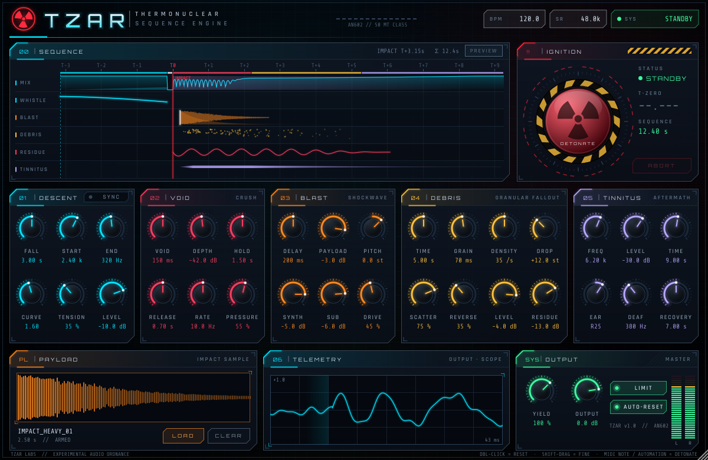

# TZAR — Thermonuclear Sequence Engine



Effet VST3 expérimental pour FL Studio (Windows x64). Un clic, une automation ou une note MIDI, et TZAR lance une séquence d'explosion nucléaire complète **sur ton mix** :

```
 DETONATE
   │
   ├─ 01 DESCENT ──── glissando de bombe qui tombe ; le mix se vide de ses basses (tension)
   ├─ 02 VOID ─────── silence absolu, 100-200 ms
   ├─ 02 CRUSH ────── IMPACT : le mix est écrasé, une onde de pression à 10 Hz le fait pomper
   ├─ 03 BLAST ────── +200 ms : l'explosion (TON sample + blast synthétique + sub drop)
   ├─ 04 DEBRIS ───── pluie granulaire taillée dans les 3 dernières secondes de TON mix,
   │                  sur un silence bizarre encore chargé de basses (résidu ~30 Hz)
   └─ 05 TINNITUS ─── acouphène ; le mix revient étouffé (surdité) puis récupère lentement
```

C'est **un seul plugin d'effet** qui génère aussi du son : il voit ton mix (pour l'écraser et le granuler) et ajoute ses propres sons *après* l'écrasement, donc ils ne se font jamais ducker.

---

## 1. Obtenir le .vst3

### Option A : GitHub Actions (rien à installer)
1. Crée un dépôt sur GitHub (privé, ça marche aussi) et envoie-y **tout le dossier TZAR** (glisser-déposer dans *Add file → Upload files* fonctionne).
2. Onglet **Actions** : le workflow *Build TZAR (Windows x64 VST3)* démarre tout seul (environ 6 à 10 min).
3. Une fois terminé (✓ vert), ouvre l'exécution et télécharge l'artefact **TZAR-Windows-x64** (un zip).
4. Copie le dossier `TZAR.vst3` dans `C:\Program Files\Common Files\VST3\`.

### Option B : compiler sur ton PC
1. Installe **Visual Studio 2022 Build Tools** (gratuit) avec la charge de travail *Développement Desktop en C++* (CMake est inclus), et **Git for Windows**.
2. Double-clique sur `build_windows.bat`. Le premier lancement télécharge JUCE, puis compile (quelques minutes).
3. Réponds `o` pour installer dans le dossier VST3 (il faut lancer le script en administrateur pour que la copie passe).

Ensuite, dans FL Studio : **Options → Manage plugins → Find installed plugins**. TZAR apparaît dans les effets.

> Un `TZAR_Standalone.exe` est aussi produit, pratique pour tester l'interface hors de FL.

---

## 2. Brancher TZAR dans FL Studio

**Où le mettre** : sur un slot de la piste **Master** du mixer, de préférence *avant* ton limiteur final.

Attention : tout ce qui passe par le Master se fait écraser, y compris un impact joué sur une autre piste de FL. Deux solutions :
- charge ton impact dans le slot **PAYLOAD** de TZAR (glisser-déposer un WAV sur l'interface) : il est joué après l'écrasement ;
- ou mets TZAR sur un bus « Musique » et envoie tes impacts directement au Master.

### Déclencher la bombe (3 façons)
| Méthode | Comment |
|---|---|
| **Bouton** | Clique sur le gros bouton rouge **DETONATE**. |
| **Automation** (la façon musicale) | Menu du wrapper (flèche en haut à gauche de la fenêtre du plugin) → *Browse parameters* → clic droit sur **DETONATE** → *Create automation clip*. Dessine un saut **0 → 1** à l'endroit voulu (deux points très rapprochés, ou un point en mode *Hold*). La séquence part quand la valeur franchit 0,5 en montant. Remets la courbe à 0 avant le prochain tir. |
| **Note MIDI** | Ajoute un canal **MIDI Out** réglé sur un port (par exemple 1). Dans les réglages du wrapper de TZAR (icône engrenage), section MIDI, mets *Input port* sur ce même numéro. N'importe quelle note du piano roll déclenche, au sample près. |

**Astuce SYNC** : active **SYNC** dans DESCENT, règle FALL sur 8 temps, place le déclenchement 8 temps (2 mesures) avant ton drop : l'impact tombe pile sur le premier temps.

**ABORT** coupe la séquence à tout moment. Avec **AUTO-RESET** activé, stopper la lecture de FL annule aussi la séquence, pour ne jamais rester avec un mix écrasé.

---

## 3. Les contrôles

**Raccourcis** : double-clic = valeur par défaut · Shift + glisser = réglage fin · molette OK · survole un potard pour l'aide en français.

| Module | Potards |
|---|---|
| **01 DESCENT** | FALL (durée, ou en temps avec SYNC) · START / END (fréquences du sifflement) · CURVE (accélération de la descente) · TENSION (passe-haut sur le mix pendant la chute) · LEVEL |
| **02 VOID / CRUSH** | VOID (silence) · DEPTH (écrasement) · HOLD · RELEASE · RATE (onde de pression, 10 Hz) · PRESSURE (0 % = écrasement continu, 100 % = le mix pulse à travers) |
| **03 BLAST** | DELAY (son après l'impact) · PAYLOAD (ton sample) · PITCH · SYNTH (blast intégré) · SUB (90 → 28 Hz) · DRIVE |
| **04 DEBRIS** | TIME · GRAIN · DENSITY · DROP (les fragments retombent en hauteur) · SCATTER · REVERSE · LEVEL · RESIDUE (le grondement grave qui charge le silence) |
| **05 TINNITUS** | FREQ · LEVEL (plafonné à -12 dB) · TIME · EAR (oreille touchée) · DEAF (passe-bas de surdité, OFF à fond) · RECOVERY |
| **SYS** | YIELD (volume de tout ce que TZAR génère) · OUTPUT · LIMIT (soft-clip de sécurité) · AUTO-RESET |

La **timeline** en haut montre toute la séquence calculée à partir de tes réglages (PREVIEW), puis suit la tête de lecture en direct (LIVE). Elle est graduée en T-/T+ autour de l'impact.

---

## 4. Trois recettes

- **Frappe tactique** (transition de 2 s) : FALL 1,5 s · VOID 120 ms · HOLD 0,6 s · DEBRIS TIME 2 s · TINNITUS TIME 3 s · RECOVERY 2 s.
- **Tsar Bomba** (break dramatique) : FALL 6 s · CURVE 2,2 · TENSION 70 % · HOLD 3 s · PRESSURE 80 % · SUB +0 dB · DEBRIS TIME 12 s · DENSITY 60 · DROP 24 st · DEAF 200 Hz · RECOVERY 20 s · YIELD 130 %.
- **Fantôme** (expérimental, sans blast) : SYNTH OFF · SUB OFF · PAYLOAD OFF · DEPTH -80 dB · PRESSURE 100 % · RATE 6 Hz · GRAIN 250 ms · REVERSE 70 % · TINNITUS LEVEL -40 dB.

---

## 5. Notes

- **Oreilles** : l'acouphène est volontairement plafonné et le limiteur est actif par défaut. Le blast peut quand même être très fort : baisse le volume de ton casque la première fois.
- Les **débris** sont fabriqués à partir de ce qui jouait juste avant l'impact. Sur une piste vide, TZAR bascule sur des fragments de bruit.
- Le chemin du sample PAYLOAD est sauvegardé dans le projet FL. Si tu déplaces le fichier, recharge-le.
- **Latence** : zéro. CPU : environ 6 % d'un cœur dans le pire cas (densité et grains au maximum), quasi nul au repos.

### Structure du code
```
Source/dsp/TzarEngine.*        moteur DSP en C++ pur (aucune dépendance JUCE)
Source/PluginProcessor.*       paramètres, déclencheurs (automation/MIDI/UI), sample, télémétrie
Source/PluginEditor.*          assemblage de l'interface, flash et onde de choc à l'impact
Source/ui/                     LookAndFeel, potards HUD, timeline, bouton DETONATE, scope
tools/render_demo.cpp          rendu audio hors ligne du moteur (démo)
tools/snapshot.cpp             captures de l'interface hors ligne
tools/hosttest.cpp             mini-hôte VST3 : charge TZAR.vst3 et le teste (audio, état, éditeur)
```

### Licences
- Framework **JUCE 8** (téléchargé à la compilation) : AGPLv3 ou licence JUCE (gratuite pour un usage personnel ou un petit chiffre d'affaires). Vérifie juce.com/legal si tu comptes distribuer ou vendre TZAR.
- Polices **Orbitron**, **Rajdhani** et **Share Tech Mono** : SIL Open Font License (voir `Resources/fonts/OFL-LICENSE.txt`).
